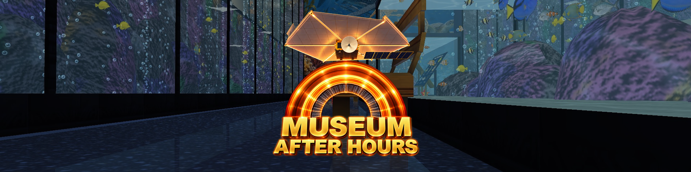
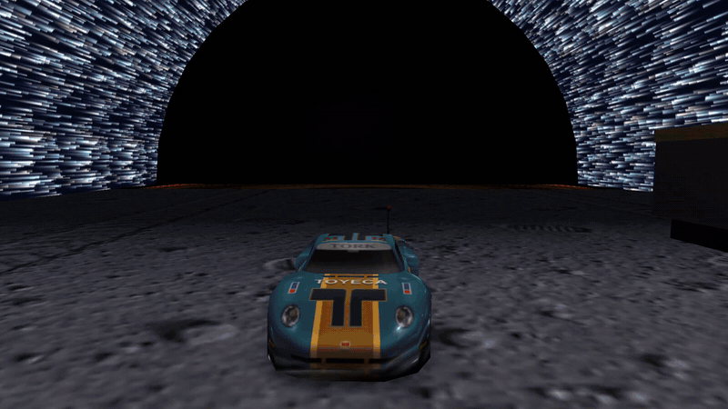
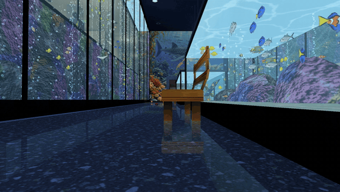
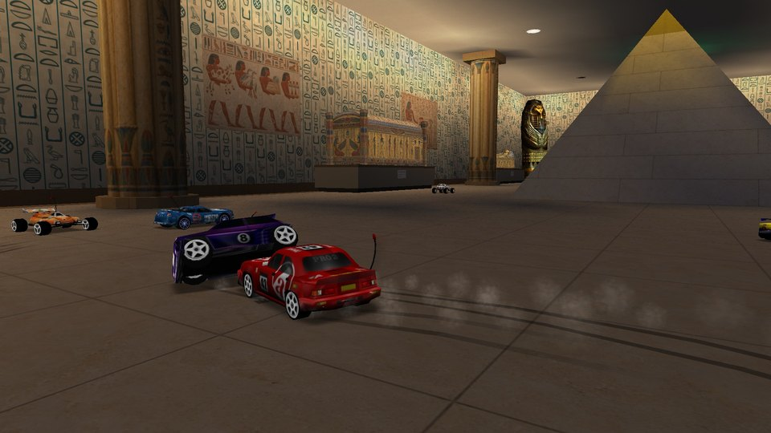
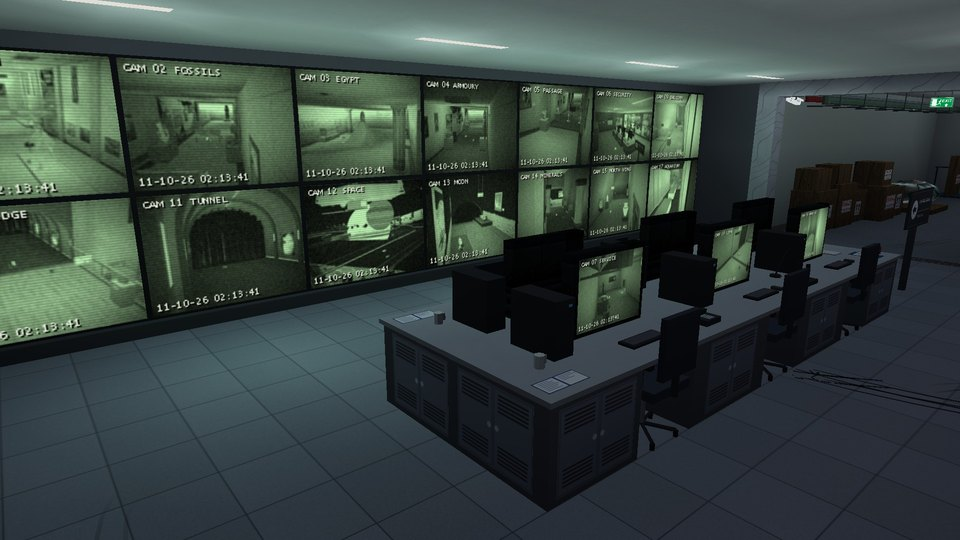
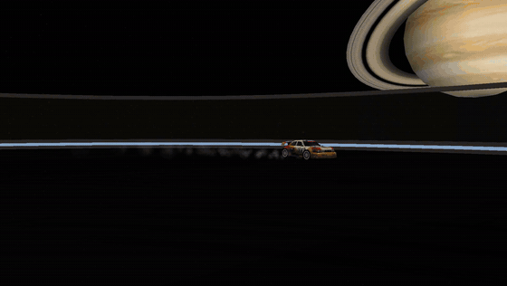
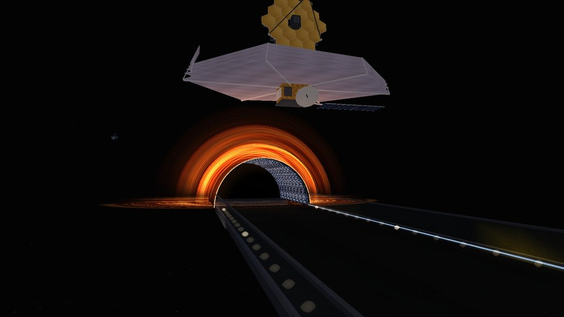
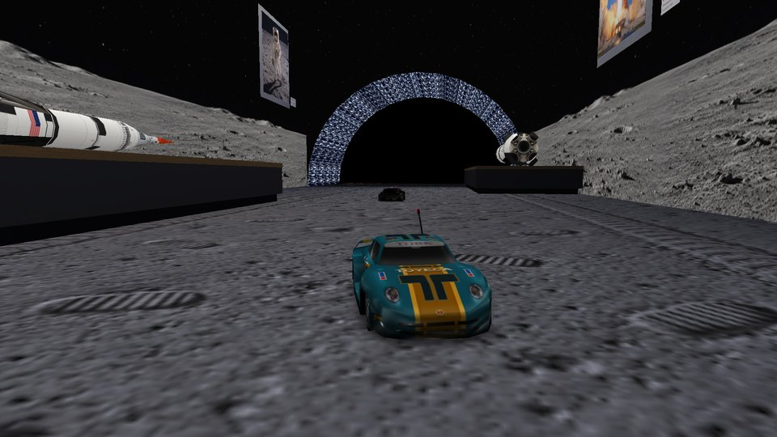
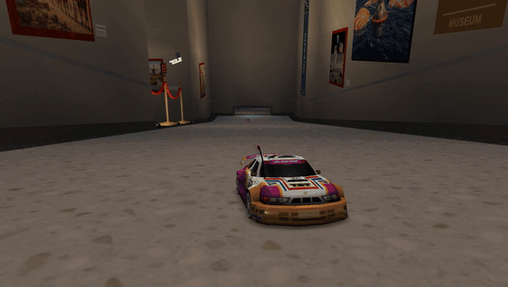

  
  
  
  

<b>The museum has closed for the night, the lights are low and the cameras are still recording.</b> 
A track for RVGL: two storeys of galleries, a glass road round the Sun, a black hole and an aquarium, raced both ways.

  <a href="#-download"><b>Download</b></a> ·
  <a href="#-the-track"><b>The track</b></a> ·
  <a href="#-a-tour-of-the-museum"><b>Tour</b></a> ·
  <a href="#-versions"><b>Versions</b></a> ·
  <a href="#-reporting-a-problem"><b>Report</b></a> ·
  <a href="#-credits"><b>Credits</b></a>

## 🏁 The track

<table>
  <tr>
    <td align="center" width="25%"><h3>623 m</h3>as shown in game</td>
    <td align="center" width="25%"><h3>Normal</h3>difficulty</td>
    <td align="center" width="25%"><h3>0:40.000</h3>Time Trial challenge, both ways</td>
    <td align="center" width="25%"><h3>Reverse</h3>the lap the other way round</td>
  </tr>
</table>

The lap runs through two storeys of galleries and passes under itself three times. It starts in the atrium under the bridge, between a stegosaurus, a life-size velociraptor and three pteranodons in flight, and runs west through the fossil corridor, under two display tables. It turns north through the Egyptian hall, where a pyramid with a gilded tip splits the road, then east through the armoury. Through the service door it squeezes into an air vent and comes out in the security room, for a patrol lap round the CCTV control desk under a video wall of fourteen monitors.

The service corridor climbs to the balcony, crosses the bridge over the start and enters the planetarium through a spaceship tunnel, past jets of CO2. A glass road hangs in the dark round a 10 m Sun, with the rocky planets under the glass, Jupiter and Saturn over the road and a 27.5 m Saturn V in flight beside it. At the end of the north arm the road dives into the throat of a 3D black hole, with hyperspace inside. Then come the Moon corridor, under Earthrise, and the mineral hall. The last ramp dives into the deep, its depth marks running down to 4,000 m, into the aquarium: floor-to-ceiling tanks with 486 fish always swimming, a whale skeleton overhead and a tank of moon jellies on the way back to the atrium.

What to expect in a race:

- two storeys, a lap that passes under itself three times and a 0.45 m high air vent into the security room;
- four branches that the CPU cars take only in races with pickups on: round the allosaurus, round the pyramid, the east half of the Sun's ring with a jump over a gap in the glass, and the east lane of the aquarium;
- 23 pickups, a practice star over the tip of the pyramid, direction arrows at every turn and a Fork arrow before the aquarium lane;
- animated fish, jellies, planets and asteroid belt, CO2 jets and runway lights blinking in the cars' direction;
- eighteen security cameras round the lap, used by the replay camera;
- the machines of the closed museum: air handling, display cases, aquarium pumps, fans and a ticking clock, one sound at a time along the lap.

## 🎬 A tour of the museum

<table>
  <tr>
    <td width="50%"></td>
    <td width="50%"><h3>The aquarium</h3>Floor-to-ceiling tanks with 486 fish always swimming, a whale skeleton overhead and a tank of moon jellies.</td>
  </tr>
  <tr>
    <td width="50%"><h3>The Egyptian hall</h3>A pyramid with a gilded tip splits the road, hieroglyphs on every wall; the practice star floats over the tip.</td>
    <td width="50%"></td>
  </tr>
  <tr>
    <td width="50%"></td>
    <td width="50%"><h3>The security room</h3>In through a 0.45 m high air vent, a patrol lap round the CCTV control desk under a wall of fourteen monitors.</td>
  </tr>
  <tr>
    <td width="50%"><h3>A glass road round the Sun</h3>The rocky planets under the glass, Jupiter and Saturn over the road and a 27.5 m Saturn V in flight beside it.</td>
    <td width="50%"></td>
  </tr>
  <tr>
    <td width="50%"></td>
    <td width="50%"><h3>Into the black hole</h3>At the end of the north arm the road dives into the throat of a 3D black hole, with hyperspace inside.</td>
  </tr>
  <tr>
    <td width="50%"><h3>The Moon corridor</h3>Regolith underfoot, the lunar module and Earthrise overhead, then the mineral hall.</td>
    <td width="50%"></td>
  </tr>
  <tr>
    <td width="50%"></td>
    <td width="50%"><h3>Two storeys of galleries</h3>Fossils, the armoury, the balcony and the bridge over the start: the lap passes under itself three times.</td>
  </tr>
</table>

Trailer: [Museum After Hours](https://youtu.be/ps5jYddnTJ4)

## 📦 Download

Grab `Museum_After_Hours_<version>.zip` from the [latest release](https://github.com/6up3r/rvgl-museum-after-hours/releases/latest): the same file as on [Re-Volt World](https://www.revoltworld.net/dl/museum-after-hours/).

Extract the archive into your RVGL folder so that the `levels` and `gfx` folders merge with the existing ones. The track appears in the track list as **Museum After Hours**; the reverse version is in the same entry. The readme inside the archive, in `levels/mu_afterhours/`, carries the full changelog and credits.

## 🗂️ Versions

Every release published on Re-Volt World is here, the latest first. Each release carries its changes.

| Version | Released | What changed |
| --- | --- | --- |
| [1.1](https://github.com/6up3r/rvgl-museum-after-hours/releases/tag/v1.1) | 23 October 2026 | the whole track lighter without losing detail |
| [1.0.2](https://github.com/6up3r/rvgl-museum-after-hours/releases/tag/v1.0.2) | 22 October 2026 | the pyramid fixed, a smoother aquarium |
| [1.0.1](https://github.com/6up3r/rvgl-museum-after-hours/releases/tag/v1.0.1) | 21 October 2026 | the entrance sill and the security room desks fixed |
| [1.0](https://github.com/6up3r/rvgl-museum-after-hours/releases/tag/v1.0) | 18 October 2026 | first release |

## 🛠️ Reporting a problem

Something looks, drives or sounds wrong? Open the [track report form](https://github.com/6up3r/rvgl-museum-after-hours/issues/new?template=track.yml): one report per problem, with the spot on the lap and a screenshot where it shows. The author reads every report; the fix comes in a later release.

## 🙏 Credits

- **Acclaim Studios London, Re-Volt (1999):** textures, models and sounds of the original game, from Museum 1, Museum 2, the Probe UFO and the game's sound effects. Many are reworked for this track: the skeletons in bone, the Saturn V scaled up with a new livery, engines and flame, the lunar module relit, the scarab standing, the START banner redrawn, and the ambient sounds pitched, cut or mixed into new loops.
- **Tools:** Blender 2.79b with Marv's Re-Volt add-on (Marvin Thiel, GPL-3.0), Python. Developed with OpenAI Codex and Claude Code (CLI), and tested with rvlab, the author's own command-line test kit.

<b>Use of AI tools</b>

 

- Paintings, finishes, signs, murals and planet maps started from GPT (OpenAI) images made on the author's directions, then fitted and placed in the track by the author.
- Several museum models (Egyptian pieces, dinosaurs, skeletons, cameras, ISS, James Webb) were delivered by Codex (OpenAI) and reworked on import.
- The fish are built in 3D by the author's own scripts from GPT images; the black hole, the hyperspace and the CO2 jets are made by those scripts alone.

 
Made by <b>6Up3r</b> · also by the author: <a href="https://github.com/6up3r/rvgl-supermarket-after-hours">SuperMarket After Hours</a> · <a href="https://github.com/6up3r/rvgl-car-importer-releases">RVGL Car Importer</a>

